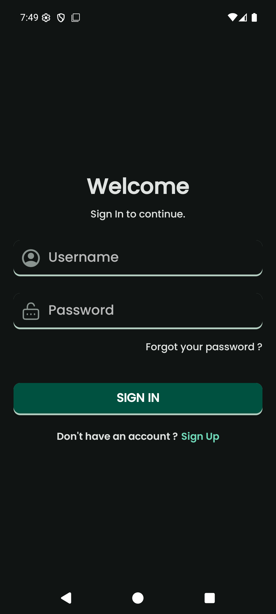
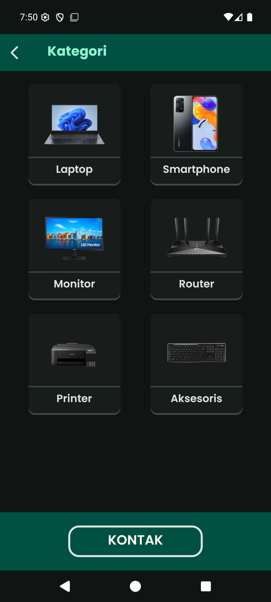
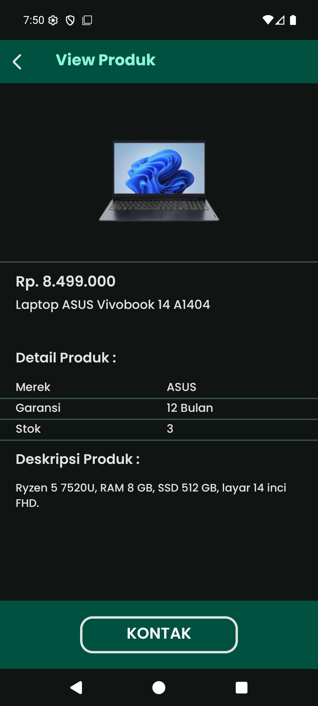

# Device Point 📦

Aplikasi katalog produk berbasis Android. Menampilkan daftar barang per kategori
(laptop, smartphone, monitor, router, printer, aksesoris), lengkap dengan harga,
merek, garansi, stok, dan deskripsi. Ada dua peran: **pengguna** yang menjelajah
katalog, dan **admin** yang mengelola produk.

Aplikasi berjalan sepenuhnya offline dengan SQLite lokal — tidak ada server,
tidak ada request jaringan selain tombol kontak WhatsApp.

## Fitur

**Pengguna**
- Daftar akun dan login (password disimpan sebagai hash, lihat [Keamanan](#keamanan))
- Jelajah katalog per kategori
- Cari produk berdasarkan nama atau merek, dan urutkan berdasarkan nama atau harga
- Detail produk: harga, merek, garansi, stok, deskripsi
- Tombol hubungi penjual lewat WhatsApp

**Admin**
- Tambah, ubah, dan hapus produk
- Unggah foto produk dari galeri — foto otomatis diperkecil dan dikompres
- Halaman admin diproteksi ulang di database, bukan hanya dari status login

## Akun demo

```
username: admin
password: admin123
```

Akun ini dibuat otomatis saat database pertama kali dibuat, supaya aplikasi bisa
dicoba langsung setelah dipasang. Untuk pemakaian nyata, daftar akun sendiri lewat
halaman Sign Up — akun baru otomatis bukan admin.

## Tech stack

| Bagian | Teknologi |
|---|---|
| Bahasa | Java 17 |
| UI | XML layout + ViewBinding, Material Components, Poppins |
| Database | SQLite lewat `SQLiteOpenHelper` (versi skema 5) |
| Gambar | Glide |
| Build | Gradle 9.8.2, Android Gradle Plugin 9.4.1 |
| SDK | `minSdk 24` (Android 7.0) · `targetSdk`/`compileSdk` 36 |
| IDE | Android Studio |

## Struktur proyek

```
app/src/main/java/com/zierch/devicepoint/
├── PasswordHasher.java        # PBKDF2 hash + verifikasi
├── ImageStore.java            # simpan/perkecil/hapus foto produk
├── SQLiteHelper.java          # skema, migrasi, query produk & pengguna
├── Helper.java                # helper perpindahan activity
├── ListProdukAdapter.java     # adapter daftar produk
└── ui/
    ├── SplashScreenActivity.java
    ├── SignInActivity.java
    ├── SignUpActivity.java
    ├── KategoriActivity.java      # daftar kategori
    ├── ListProdukActivity.java    # produk per kategori + cari & urutkan
    ├── ViewProdukActivity.java    # detail produk
    ├── ContactActivity.java       # kontak penjual (WhatsApp)
    └── admin/
        ├── HomeActivity.java      # beranda admin
        └── FormProduk.java        # tambah/ubah produk + unggah gambar

app/src/test/java/com/zierch/devicepoint/
├── SQLiteHelperTest.java      # CRUD, migrasi, pencarian, pengurutan
└── PasswordHasherTest.java    # hashing & verifikasi
```

## Skema database

**users** — `id`, `username` (unik), `password_hash`, `is_admin`

**products** — `id`, `image`, `kategori`, `nama_produk`, `harga`, `merek`,
`garansi`, `stok`, `deskripsi`

Kategori bawaan: Laptop, Smartphone, Monitor, Router, Printer, Aksesoris.

## Keamanan

- Password **tidak pernah** disimpan sebagai teks biasa. Yang tersimpan adalah
  hasil PBKDF2-HMAC-SHA256, 120.000 iterasi, salt acak 16 byte per akun
  (`PBKDF2WithHmacSHA1` dipakai sebagai fallback di Android 7–8 yang belum punya
  varian SHA256). Nama algoritma ikut disimpan bersama hash.
- Verifikasi memakai perbandingan waktu tetap (`MessageDigest.isEqual`).
- Password tidak lagi ditulis ke `SharedPreferences` — hanya username yang
  disimpan, dan itu pun hanya setelah kredensial terbukti benar.
- Migrasi skema 4 → 5 mengubah kolom `password` menjadi `password_hash` sambil
  men-hash ulang data lama, tanpa `DROP COLUMN` yang belum ada di SQLite Android 7.
- Skema masih menyimpan data di penyimpanan privat aplikasi; ini aplikasi demo
  offline, bukan sistem multi-pengguna di server.

## Menjalankan

Lewat Android Studio: buka folder proyek, lalu Run.

Lewat terminal:

```bash
./gradlew assembleDebug          # Linux/macOS
gradlew.bat assembleDebug        # Windows
```

Butuh JDK 17 atau lebih baru. APK hasil build ada di
`app/build/outputs/apk/debug/app-debug.apk`.

## Test

```bash
./gradlew test          # Linux/macOS
gradlew.bat test        # Windows
```

15 test unit (Robolectric, tanpa perlu emulator) mencakup:

- login akun seed dan akun baru, penolakan password salah, akun baru bukan admin
- username duplikat diabaikan, password tersimpan sebagai hash
- migrasi database skema 4 → 5 tetap bisa login dan data produk tidak hilang
- pencarian nama/merek, keempat mode urutan, isolasi kategori
- update dan hapus produk
- hashing: round-trip, salt berbeda tiap hash, hash yang diubah ditolak,
  algoritma tak dikenal dan format rusak ditolak

<!--
## Screenshot

_Tambahkan setelah gambar diambil dari emulator (jangan dari HP pribadi):_

| Login | Katalog | Detail | Admin |
|---|---|---|---|
|  |  |  |  |
-->

## License

MIT — lihat [LICENSE](LICENSE).
